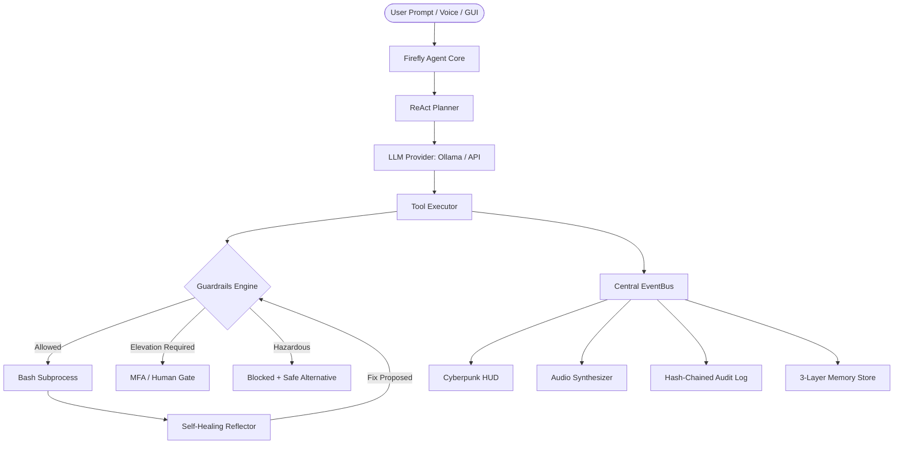

# System Architecture

Firefly Mini follows a modular, decoupled, event-driven architecture designed for zero global state, low latency, and offline independence.

---

## Core Subsystems

### 1. Structure & Dependency Injection
- **`firefly.core.container`**: Hierarchical DI container binding interfaces to concrete instances without globals.
- **`firefly.core.events`**: Asynchronous pub/sub event bus decoupling UI, audio, and logging from the ReAct reasoning core.
- **`firefly.core.result`**: `Result[T, E]` type pattern replacing scattered exceptions with explicit flow control.

### 2. Guardrails & Safety
- **`firefly.core.guardrails`**: AST lexer and pattern engine scanning commands for forbidden files, destructive verbs, subshell evasion, and fork bombs.
- **`firefly.security`**: Policy-as-code YAML engine, least-privilege permission scopes, Bubblewrap sandboxing, prompt-injection defense, and rate limiters.

### 3. Adaptive Memory
- **`firefly.memory.store`**: 3-layer store with decay scoring, contradiction detection, and AES-GCM encryption at rest.
- **`firefly.memory.redactor`**: Real-time secret and credential scrubber protecting memory, prompts, logs, and audio.

### 4. Audio Subsystem
- **`firefly.voice.synthesizer`**: Procedural mathematical wave audio generator creating 8 16-bit PCM WAV soundbites with zero external media files.
- **`firefly.voice.speaker`**: CyberSpeaker with PipeWire, PulseAudio, ALSA, and ffmpeg player auto-selection.
- **`firefly.voice.listener`**: VAD silence gating and Whisper transcription loop.
